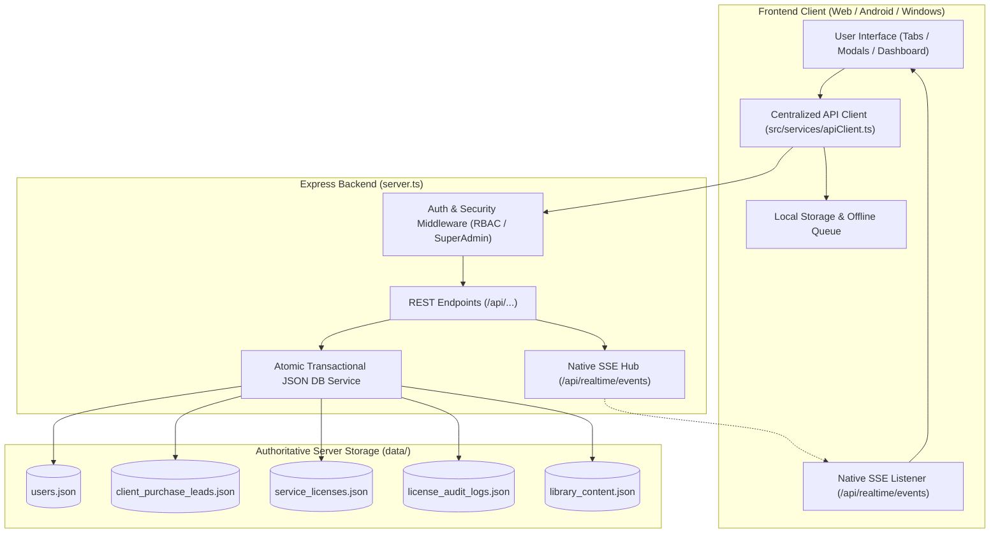

# Phase 1: Comprehensive Project Architecture Audit Report
**Project:** बालानन्द ज्योतिष, वास्तु तथा कर्मकाण्ड सेवा (Nepali Vedic Jyotish & Panchanga)  
**Date:** २०८१ / October 2026  
**Auditor:** Antigravity Advanced Agentic AI System  

---

## 1. Executive Summary & Detected Stack

| Layer | Detected Technology / Framework | Architecture Role |
| :--- | :--- | :--- |
| **Frontend Framework** | React 19 (`react: ^19.0.1`, `react-dom: ^19.0.1`), Vite 6, Tailwind CSS 4 | Single Page Application (SPA) with lazy-loaded views for 40+ Vedic tabs |
| **Backend Framework** | Node.js Express 4.21 (`express: ^4.21.2`), bundled via `esbuild` to `dist/server.cjs` | RESTful API server, static asset host, and background calculation coordinator |
| **Authoritative Database** | JSON-file database engine with structured file stores in `data/` | Authoritative transactional persistence for users, client purchase leads, licenses, trials, and audit logs |
| **Client Storage / Cache** | Browser `localStorage`, In-Memory Caches, and `BroadcastChannel` | Client-side offline cache, session persistence, and local device profile store |
| **Multi-Platform Shells** | Android (`@capacitor/android: ^8.5.2`), Windows Desktop (`electron: 35.0.0`, `electron-builder`) | Native mobile APK and Windows NSIS/portable desktop distribution |
| **Astronomical Engines** | Custom Surya Siddhanta & Lahiri Vedic ephemeris engines, `three.js` (Vastu 360), `recharts` | Authentic Vedic Janma Kundali, Dasha, Gochar, Panchanga, and Vastu 81-pada calculations |

---

## 2. Existing File Structure & Responsibilities

### 2.1 Backend Server (`server.ts`)
- **Total Lines:** 3,912 lines.
- **Responsibilities:**
  1. **Superadmin Authentication:** `POST /api/superadmin/login`, `GET /api/superadmin/auth-check`, `POST /api/superadmin/logout`, rate-limiting failed logins (5 attempts / 10 min lock).
  2. **Service Access & Licensing:** `GET /api/service-access`, `GET /api/licenses/check`, `GET /api/licenses/all`, `POST /api/licenses/mutate`, `GET /api/licenses/audit-logs`.
  3. **Client Purchase Leads:** `GET /api/client-leads`, `POST /api/client-leads`, `POST /api/client-leads/submit`, `POST /api/client-leads/:id/approve`, `POST /api/client-leads/approve-by-tx`, `POST /api/client-leads/:id/reject`, `DELETE /api/client-leads/:id`.
  4. **RBAC & User Authentication:** `POST /api/auth/register`, `POST /api/auth/login`, `GET /api/users`, `POST /api/users/:id/update-status`, `DELETE /api/users/:id`, `DELETE /api/superadmin/users/:id`.
  5. **Superadmin User Master:** `GET /api/superadmin/users`, `GET /api/superadmin/users/:id`, `PATCH /api/superadmin/users/:id`, `POST /api/superadmin/users/:id/status`, `POST /api/superadmin/users/:id/notes`, `POST /api/superadmin/users/:id/trial`.
  6. **Data Reset:** `POST /api/superadmin/system-reset`.
  7. **User Profile & Favorites:** `PUT /api/users/:id/profile`, `POST /api/users/:id/profile-picture`, `GET /api/users/:id/favorites`, `POST /api/users/:id/favorites/toggle`.
  8. **AI Engine:** Google Gemini integration for daily/monthly/yearly horoscopes and horoscope interpretations.
  9. **Software Releases & Distribution:** Serving Windows setup `.exe` and Android `.apk` binaries from `public/downloads`.

### 2.2 Client-Side Stores (`src/db/`)
- `rbacStore.ts`: Role-based access control, account registration, session validation, active session store.
- `clientLeadStore.ts`: eSewa and payment purchase leads, 24-hour trial initiation, purchase approval status.
- `subscriptionStore.ts`: eSewa payment proof submission, pricing plans, 7-day trial evaluation, print restriction enforcement.
- `serviceLicenseStore.ts`: Jyotish and Vastu user-specific licenses, purchase request submission and actioning.
- `profileStore.ts`: Multi-tenant Janma Kundali birth profiles, gotra, rashi, astrologer/purohit profiles.
- `menuControlStore.ts`: Individual menu item permission toggles and custom client access control.
- `pageServiceControlStore.ts`: Page maintenance and lockdown controls.
- `securityBlacklist.ts`: Permanent deletion blacklist prevention.
- `softwareReleaseStore.ts`: Software version catalog and downloads metadata.
- `samacharStore.ts`: News articles, categories, and magic token verification.
- `vivahStore.ts`: Marriage profiles, partner preferences, advertisements, and moderation.
- `vedicStore.ts`: Puja samagri store products, cart, wishlist, orders, and POS billing.
- `yajamanStore.ts`: Purohit/Astrologer service bookings, yajaman user requests, reviews, and notifications.
- `aarjeStore.ts`: Lost-and-found horary astrology inquiry records.

### 2.3 Core Frontend Views (`src/components/`)
- `App.tsx`: Central master coordinator, sub-navigation tabs, role detection, license unlock verification.
- `SuperAdminUserManagementTable.tsx`: Master administrative dashboard for user moderation, eSewa purchase approval, service unlocking, and system reset.
- `PurchaseSubscriptionView.tsx`: Customer-facing subscription plans and eSewa payment proof submission modal with 5 required fields.
- `UserDashboardView.tsx`: Customer dashboard with personalized daily, monthly, and yearly rashifal, birth details editor, and photo cropper.
- `SewaMainView.tsx`: Hub for Vedic Astrology and 360° Vastu Shastra services.
- `KundaliView.tsx`, `PatrikaView.tsx`, `FaladeshView.tsx`, `DashaView.tsx`, `GocharView.tsx`, `PanchangaView.tsx`: Deep Vedic astronomical calculation and rendering modules.

---

## 3. Critical Findings & Architectural Deficiencies

### Finding 1: Third-Party External SSE Relay Dependency (`ntfy.sh`)
- **Problem:** Real-time updates currently push and subscribe to `https://ntfy.sh/balananda_jyotish_realtime_sync_v2081`.
- **Risks:**
  - Public visibility: any party listening to that public topic could see notifications.
  - Network vulnerability: if `ntfy.sh` is blocked or offline, real-time sync fails completely.
  - Violates Phase 5 requirement for an authoritative, self-contained backend notification workflow.
- **Action Required:** Implement a native Express Server-Sent Events endpoint (`/api/realtime/events`) with connection management, heartbeat, and local authenticated broadcast.

### Finding 2: Unsafe Fallback to Public GitHub Raw Content (`raw.githubusercontent.com`)
- **Problem:** `unifiedUserSyncService.ts` lines 1442 & 1463 contain fallbacks to fetch `data/users.json` and `data/client_purchase_leads.json` from `https://raw.githubusercontent.com/...`.
- **Risks:**
  - Violates Phase 4: "GitHub and the local computer drive must not be treated as the authoritative live application database."
  - Could leak user records if `data/users.json` is checked into a public repository.
- **Action Required:** Strip out all raw GitHub content polling for user data. Keep GitHub strictly for version control, CI/CD, and release asset distribution.

### Finding 3: Missing Backend API Client & Scattered `fetch()` Calls
- **Problem:** Over 25 files make direct `fetch()` calls with inconsistent base URLs, header handling, and failure modes.
- **Risks:**
  - In Android Capacitor or Electron, relative paths like `/api/users` fail if a base origin is not configured.
  - In Node test runners, relative URLs throw `ERR_INVALID_URL`.
  - Lack of retry policy, request deduplication, or offline queueing.
- **Action Required:** Build a centralized `apiClient.ts` service with automatic origin detection, authorization header injection, request timeout, deduplication, and offline queueing.

### Finding 4: Disconnect Between Local Stores and Server Persistence
- **Problem:**
  - `updateRBACUserProfile` in `rbacStore.ts` only writes to `localStorage` and does not call `PUT /api/users/:id/profile`.
  - `samacharStore.ts`, `aarjeStore.ts`, `vivahStore.ts`, and `vedicStore.ts` maintain isolated `localStorage` state without persisting records to authoritative backend JSON files.
- **Risks:** Data entered on one device does not appear when accessed from another device or when Superadmin inspects the backend database.
- **Action Required:** Connect profile, article, and service request actions to dedicated backend endpoints with atomic disk persistence.

### Finding 5: Concurrency & File Integrity in `server.ts`
- **Problem:** `server.ts` uses direct synchronous `fs.writeFileSync` to write JSON files without atomic file swapping or write locking.
- **Risks:** If two requests write simultaneously or if the server crashes mid-write, the JSON file could be corrupted.
- **Action Required:** Implement an atomic file write utility (`fs.writeFileSync(tmp) -> fs.renameSync(tmp, dest)`) with an in-memory lock/queue.

### Finding 6: Controlled User-Data Reset (Phase 7)
- **Problem:** The previous reset wiped files directly without providing a preview, backup export, or multi-step confirmation.
- **Action Required:** Implement a formal, two-step data-reset workflow:
  1. `/api/superadmin/data-reset/preview`: lists record counts and target scope.
  2. `/api/superadmin/data-reset/execute`: requires explicit confirmation code (`CONFIRM_PURGE_2081`), preserves administrative accounts, library content, and software release configs, and logs a minimal audit entry.

---

## 4. Features That Work and Must Remain Intact
1. **Vedic Ephemeris & Calculations:** All Swiss/Lahiri ayanamsa planetary calculations, Kundali chart generation (North/South Indian), Ashtakavarga, Vimshottari Dasha, transit alerts, and Vastu 360° compass.
2. **Nepali Calendar Converter:** Accurate BS <-> AD conversions and Panchanga calculations.
3. **Super Admin User Management:** Dual-table view, 8 KPI statistics filters, Right-Click Context Menu, and Menu Control Switchboard.
4. **Millisecond Security Force-Signout:** Real-time account locking, deactivation, and visitor mode downgrade with 35/35 passing tests.
5. **eSewa 5-Field Verification:** Name, Address, Mobile, WhatsApp, and Transaction Code capture and validation.

---

## 5. Architectural Rebuild Blueprint (Phases 2 – 11)

